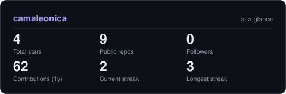
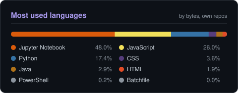

<!-- BANNER - terminal profile.sh --live. Generated by scripts/banner/generate.py -->
<picture>
  <source media="(prefers-color-scheme: dark)"  srcset="assets/banner-dark.svg">
  <source media="(prefers-color-scheme: light)" srcset="assets/banner-light.svg">
  
</picture>

 

<!-- NAME / TAGLINE - animated typing -->

 

&nbsp;&nbsp;
&nbsp;&nbsp;

 

---

## This is me

Hi, I'm **Candela**, a Computer Engineering student at **UADE**, broadcasting from Buenos Aires, Argentina.
I build things to understand how they work.

- Final-year student focused on building **clean and functional software**.
- Working on academic and personal projects involving **backend development, APIs and databases**, with some frontend experimentation on the side.
- Interested in the intersection between **engineering, creativity and problem-solving**.
- Always learning.

 

## my stack

---

## signals

<table>
<tr>
<td width="50%" align="center" valign="middle">

<!-- Self-rated radar - edit assets/skills.json, the workflow redraws it -->
<picture>
  <source media="(prefers-color-scheme: dark)"  srcset="assets/radar-dark.svg">
  <source media="(prefers-color-scheme: light)" srcset="assets/radar-light.svg">
  
</picture>

</td>
<td width="50%" align="center" valign="middle">

<!-- Language radar - edit assets/langmix.json -->
<picture>
  <source media="(prefers-color-scheme: dark)"  srcset="assets/radar-langs-dark.svg">
  <source media="(prefers-color-scheme: light)" srcset="assets/radar-langs-light.svg">
  
</picture>

</td>
</tr>
</table>

---

## numbers

<!-- Generated by scripts/cards.py into this repo, so it never depends on a shared public instance -->
<picture>
  <source media="(prefers-color-scheme: dark)"  srcset="assets/card-stats-dark.svg">
  <source media="(prefers-color-scheme: light)" srcset="assets/card-stats-light.svg">
  
</picture>

 

<picture>
  <source media="(prefers-color-scheme: dark)"  srcset="assets/card-langs-dark.svg">
  <source media="(prefers-color-scheme: light)" srcset="assets/card-langs-light.svg">
  
</picture>

---

` built with love · @camaleonica `

